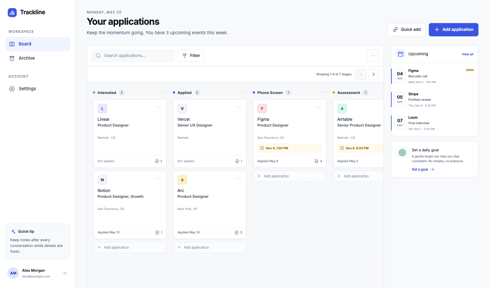
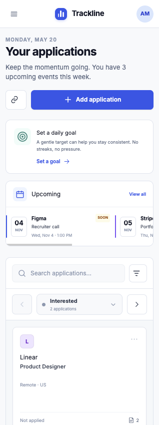

# Trackline

Trackline is a responsive web application for organizing and monitoring job applications. It gives users a single workspace for recording opportunities, moving applications through hiring stages, keeping notes, reviewing application history, and maintaining daily search goals.

The project is designed for students, recent graduates, career changers, and others managing multiple applications across a changing job search. It provides a practical alternative to spreadsheets or disconnected documents by presenting the job-search process in a focused Kanban-style interface.

## Screenshots

### Desktop Dashboard



### Mobile Dashboard



## Table of Contents

- [Features](#features)
- [Technology Stack](#technology-stack)
- [Getting Started](#getting-started)
- [Project Structure](#project-structure)
- [Application Workflow](#application-workflow)
- [Data Management and Persistence](#data-management-and-persistence)
- [Responsive Design](#responsive-design)
- [Development Status](#development-status)
- [Roadmap](#roadmap)
- [Academic Context](#academic-context)

## Features

### Implemented application features

- **Kanban application board** — Applications are grouped by hiring stage, including Interested, Applied, Phone Screen, Assessment, Interview, Final Interview, and Offer.
- **Application creation** — Users can add an application manually with company, role, location, employment type, stage, and related fields.
- **Application details** — Application cards open a detail drawer with overview, notes, timeline, and events views.
- **Desktop stage movement** — Applications can be moved between columns through drag-and-drop or the stage controls.
- **Mobile stage navigation** — Small screens present one hiring stage at a time with a stage selector and previous/next controls.
- **Backward move confirmation** — Moving an application backward in the hiring process prompts the user before later stage history is removed.
- **Stage history** — The Timeline view records and displays stage changes and application creation activity.
- **Timeline stage removal** — Individual timeline entries can be removed when more than one stage remains.
- **Application notes** — Users can add, edit, delete, and review timestamped notes for an application.
- **Search** — The board searches companies, roles, and locations.
- **Hiring-stage filtering** — The board filter menu limits visible applications to a selected stage.
- **Archiving and restoration** — Applications can be archived and later restored to their previous stage.
- **Archive management** — Archived applications can be searched, selected, restored, or permanently deleted.
- **Daily goals** — Users can enable a daily application target and view progress against a hard-coded demonstration progress count.
- **Upcoming events widget** — The dashboard displays prototype recruiter calls, reviews, and interview deadlines.
- **Event dialog** — Applications can open an event form for interviews, assessments, follow-ups, or other events with time-zone options.
- **Time-zone preferences** — The application detects the browser time zone and allows the preference to be saved locally.
- **Settings page** — Settings include profile information, prototype calendar connection controls, daily goals, hiring-stage presentation, and appearance controls.
- **Responsive navigation** — The desktop sidebar becomes a fixed mobile header and drawer-style navigation on smaller screens.
- **Local feedback** — Toast notifications provide feedback for stage changes, notes, archiving, restoration, and settings actions.
- **Keyboard and accessibility behavior** — The interface uses semantic buttons and form controls, focus indicators, dialog labels, and Escape/outside-click dismissal for menus.

### Prototype-only or incomplete functionality

The following interactions are user-interface demonstrations rather than integrations with external services or complete management features:

- The authentication screen is a local UI state. The Google sign-in button only sets the application as signed in; no credentials or authentication provider are used.
- Google Calendar controls and event creation are simulated. They do not create real calendar events.
- Quick Add validates a URL and simulates a one-second import, then presents fixed demonstration application data.
- The Daily Goal widget uses a fixed completion count of `2`; it does not derive progress from applications created during the current day.
- The upcoming-event list uses fixed prototype dates and does not update from user-created events.
- Application overview editing, job-posting links, and the “show full description” controls are currently presentational rather than fully editable or external-link features.
- The profile photo, Google Calendar connection toggle, dark appearance toggle, hiring-stage reorder/rename/add controls, and settings profile fields may be UI demonstrations and do not all persist application behavior.
- The archive collection persists only for the current React session. Archived applications are not saved to localStorage and do not remain in the Archive page after a reload.

## Technology Stack

| Technology          | Purpose                                                                         |
| ------------------- | ------------------------------------------------------------------------------- |
| React 19            | Functional components and browser UI state                                      |
| React DOM 19        | Mounting the application in the browser                                         |
| TypeScript          | Static typing for components, state, and application data                       |
| Vite 8              | Development server and production bundling                                      |
| Tailwind CSS 4      | Tailwind theme and utility integration                                          |
| `@tailwindcss/vite` | Tailwind CSS 4 Vite integration                                                 |
| Custom CSS          | Primary visual implementation, layout, responsive states, and component styling |
| Oxlint              | JavaScript and React linting                                                    |

No frontend UI framework, database, backend API, Firebase package, or authentication library is currently installed.

## Getting Started

### Prerequisites

- npm
- Node.js and npm capable of running Vite 8

The repository does not currently pin a Node.js version or define an npm `engines` requirement.

### Clone and install

```bash
git clone <repository-url>
cd final-project
npm install
```

Replace `<repository-url>` with the repository's GitHub or source-control URL.

### Start the development server

```bash
npm run dev
```

Vite will print the local development URL in the terminal.

### Run lint checks

```bash
npm run lint
```

This runs the project's Oxlint configuration.

### Create a production build

```bash
npm run build
```

The build runs `tsc -b` and then creates the optimized Vite bundle in `dist/`.

### Preview the production build

```bash
npm run preview
```

Run this after a successful production build to serve the generated output locally.

No formatting script is currently defined in `package.json`, and Oxfmt is not installed. The available npm scripts are `dev`, `build`, `lint`, and `preview`.

## Project Structure

```text
final-project/
├── public/
│   ├── favicon.svg
│   └── icons.svg
├── src/
│   ├── assets/
│   │   ├── hero.png
│   │   ├── react.svg
│   │   └── vite.svg
│   ├── components/
│   │   └── Icon.tsx
│   ├── data/
│   │   ├── prototype.ts
│   │   └── timezones.ts
│   ├── hooks/
│   │   ├── useDismissibleMenu.ts
│   │   └── useSingleColumnBoard.ts
│   ├── types/
│   │   └── application.ts
│   ├── utils/
│   │   ├── applications.ts
│   │   └── format.ts
│   ├── App.tsx
│   ├── App.css
│   ├── index.css
│   └── main.tsx
├── index.html
├── package.json
├── package-lock.json
├── tsconfig.json
├── tsconfig.app.json
├── tsconfig.node.json
└── vite.config.ts
```

### Main directories

- `src/App.tsx` — Application state, navigation, dashboard composition, dialogs, drawers, archive, and settings behaviors.
- `src/components/` — Shared reusable presentation components. It currently contains the icon component.
- `src/data/` — Seed applications and common time-zone values.
- `src/hooks/` — Reusable hooks for menu dismissal and mobile board behavior.
- `src/types/` — Shared TypeScript types for applications, stages, notes, pages, and modals.
- `src/utils/` — Application hydration/persistence helpers and date and time-zone formatting.
- `src/index.css` — Tailwind entry point and the custom visual system for the application.
- `public/` — Static assets served directly by Vite.
- `vite.config.ts` — React and Tailwind CSS 4 Vite plugins.

Most application-specific UI remains consolidated in `src/App.tsx`. Supporting types, data, hooks, formatting, and icon definitions have been separated into the directories above.

## Application Workflow

1. **Review the board** — Applications are displayed as cards inside their current hiring-stage columns.
2. **Search or filter** — Search by company, role, or location, or filter the board by hiring stage.
3. **Add an application** — Use the Add application dialog for manual entry, or open the prototype Quick Add flow for simulated URL import.
4. **Update progress** — Move an application by drag-and-drop on desktop or by changing its stage in the application controls.
5. **Open application details** — Review the overview, add or edit notes, inspect stage history, and open the event form.
6. **Record context** — Use notes for recruiter conversations, preparation, assessments, interviews, or follow-up details.
7. **Archive inactive opportunities** — Move applications out of the active board and restore or permanently delete them from the Archive page.
8. **Configure preferences** — Adjust the daily goal and time zone through Settings.

## Data Management and Persistence

Trackline currently uses React state and browser `localStorage`; it does not use a backend or external database.

- Applications are initialized from local prototype seed data or from the `trackline-applications` localStorage key.
- Goals are stored under `trackline-goals`.
- The selected time zone is stored under `trackline-time-zone`.
- Application changes, including stage history and notes, are written to localStorage through React effects.
- Archived applications are kept in React state only for the current session. They are not included in the application localStorage write and are lost on reload.
- `localStorage` failures fall back to in-memory application behavior where the code includes storage guards.
- There is no user account database, cloud synchronization, Firebase integration, or API-backed data source.

Because data is browser-local, applications and preferences are not synchronized across devices or browser profiles. Clearing site data removes persisted application, goal, and time-zone values.

## Responsive Design

The interface uses desktop, tablet, and mobile CSS breakpoints:

- At widths below 1,200 px, the desktop sidebar is replaced with a fixed mobile header.
- At widths below 768 px, dashboard widgets and settings navigation become mobile-oriented layouts.
- At widths below 600 px, page padding and headers are further condensed, dialogs become bottom sheets, and the Kanban interface is limited to a selected stage.
- The mobile board navigation provides stage selection and previous/next controls rather than exposing every desktop column at once.
- The archive table changes into stacked application cards on narrow screens.
- Custom CSS provides focus states, responsive dialogs, drawers, menus, cards, and table layouts.

## Development Status

Trackline is an active university final-project implementation and is currently at the functional prototype stage. The core board, application, note, timeline, archive, and local preference interfaces are implemented. Several settings and integration surfaces are intentionally demonstration-only.

The project should be considered a locally usable application prototype, not a production authentication or cloud-backed service.

## Roadmap

- [ ] Add real authentication and Google sign-in.
- [ ] Persist applications and archived items in a cloud database.
- [ ] Implement real Google Calendar event creation and synchronization.
- [ ] Replace simulated URL import with reviewed job-posting data extraction.
- [ ] Add complete application editing and removal workflows.
- [ ] Implement custom stage creation, reordering, and renaming.
- [ ] Derive daily goal progress from persisted user actions.
- [ ] Add application-level deadline and event state rather than prototype event data.
- [ ] Expand automated tests for state transitions and persistence.
- [ ] Continue accessibility improvements, including dialog focus management and complete keyboard workflows.
- [ ] Add a browser extension or listing-capture workflow for faster application entry.

## Academic Context

Trackline originated as a React and TypeScript university final project focused on helping users organize a job search more consistently. The implementation emphasizes a clear user workflow, responsive interface design, local demonstration data, and a structure that can support future backend integration.
